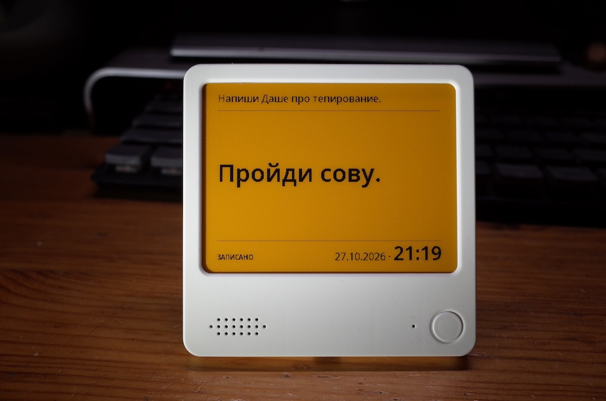

# Note4C Voice

[English](README.md) · **Русский**

Прошивка голосовых заметок для Zectrix Note4C: ESP32-S3, 16 МБ flash,
8 МБ PSRAM, цветной экран HE042A268 / SSD2683 400 × 300 и кодек ES8311.

**Версия 9 ноября 2026:** адрес сервиса распознавания и часовой пояс
задаются на странице настройки. Проверена на устройстве 9 ноября 2026.

**Версия 1 ноября 2026:** кольцевой буфер из 7 заметок, просмотр и удаление.
Загружена на устройство с сохранением NVS; USB-журнал подтвердил запуск
и обновление экрана за 24,042 секунды. Проверка буфера и кнопочных
сценариев на устройстве ещё предстоит.
Подробности: [docs/VALIDATION.md](docs/VALIDATION.md).



▶ [Видео с демонстрацией работы (YouTube)](https://www.youtube.com/shorts/uhrAeJdXi-o)

## Управление

- **Короткая круглая:** новая запись из любой позиции просмотра. После
  отпускания дождитесь сигнала, затем говорите. Новая заметка становится
  текущей; остальные сохраняются в хронологическом порядке. Всего до 7
  заметок, включая отображаемую. Восьмая вытесняет самую старую, независимо
  от выбранной позиции просмотра.
- **Down + короткая круглая:** удалить отображаемую заметку. Появится
  ближайшая более старая; при удалении самой старой — самая новая.
- **Up + короткая круглая:** перейти к ближайшей более новой заметке.
  После самой новой показывается самая старая из оставшихся.
- **Круглая 3 секунды:** настройки; удержание имеет приоритет над боковыми.

Боковую кнопку нужно удерживать при нажатии круглой: круглая будит
устройство из глубокого сна. Обе боковые вместе с короткой круглой
игнорируются. Если заметка одна, Up ничего не меняет и не обновляет экран.
При пустом буфере обе команды ничего не меняют.

Запись заканчивается после 2 секунд тишины после речи, повторного нажатия
или 30 секунд. Если речь не началась за 5 секунд, появляется сообщение
об отсутствии речи. Два коротких сигнала обозначают окончание записи.
После отправки на сервер и обновления экрана устройство засыпает.
Нажатия во время отправки и обновления игнорируются; удержанную кнопку
нужно отпустить и нажать заново. Зачёркивание «сделано» удалено.

## Экран и история

Чёрный текст на жёлтом фоне. Верхняя строка — **текст, который был на
основном экране непосредственно перед последней сменой сообщения**.
Это отдельная история экрана, а не соседняя запись в буфере.

Например: записали A, затем B — сверху A, крупно B. Удалили B — сверху B,
крупно A, хотя B уже удалена из буфера. Переход от новой заметки к самой
старой тоже переносит прежний основной текст в верхнюю строку.
Служебное сообщение может попасть в верхнюю строку, но никогда не
сохраняется как заметка в кольцевом буфере.

После удаления последней заметки **весь экран пустой жёлтый**, без верхней
строки, даты и разделителей. После новой записи с пустого экрана верхняя
строка также пустая. RESET и выход из настроек восстанавливают выбранную
заметку и её верхнюю строку без дополнительного сдвига истории.

Верхняя строка набрана шрифтом 16 px и обрезается по ширине с `...`.
Нижняя дата и время относятся к записи отображаемой заметки, в часовом
поясе из настроек. Дата — 16 px, время — 30 px, общая базовая линия.
Пунктирные разделители: Y=43 (если есть верхний текст) и Y=248
(если есть дата). Основной шрифт автоматически уменьшается до размещения
текста. Лимит — 160 символов Unicode после нормализации пробелов; более
длинный ответ обрезается до 159 символов и `…`. Поддерживаются кириллица,
ASCII и основные знаки пунктуации; остальные символы заменяются на `?`.

Примеры из настоящего буфера прошивки:
[две заметки](docs/screen-history.png),
[после удаления](docs/screen-after-delete.png),
[пустой экран](docs/screen-empty.png),
[широкие буквы](docs/screen-history-wide.png).

Новая запись, переход и удаление выполняют **полное обновление** e-ink.
При первом запуске сборки 1 ноября полный цикл занял 24,042 секунды. Промежуточные состояния записи и отправки экран
не меняют. Просмотр и удаление не включают Wi-Fi и звук.
Эксперимент с частичным обновлением сохранён отдельно в
[experiments/partial-lines](experiments/partial-lines/README.md).

## Сохранение и обновление

Буфер, выбранная позиция, даты, текст верхней строки и последнее служебное
сообщение сохраняются в NVS отдельно от настроек Wi-Fi. После глубокого
сна экран не перерисовывается; после RESET и выхода из настроек выполняется
полное восстановление выбранной заметки либо пустого экрана.

Настройки версии 1 ноября и более ранних переносятся автоматически:
Wi-Fi, NTP и громкость сохраняются, часовой пояс становится `MSK-3`, но
адреса сервиса в них нет, поэтому при первом запуске открывается портал
настройки с уже заполненными полями.

При обновлении отдельными сегментами с сохранением NVS автоматически
переносятся текущая и предыдущая заметки версии 11 октября. Зачёркивание
сбрасывается. У прежней предыдущей заметки дата не сохранялась, поэтому
она переносится без даты. Форматы NVS изменились: прошивки до 9 ноября
не прочитают ни новый буфер, ни новые настройки.

Перед изменением экрана сохраняется признак незавершённого обновления;
новое состояние фиксируется после успешного обновления. При сбое экрана
или записи NVS сохраняется последнее зафиксированное состояние. Три
вспышки LED обозначают ошибку; RESET восстанавливает сохранённое состояние.

## Первая настройка

После установки появляется инструкция подключения:

1. Подключитесь телефоном или компьютером к Wi-Fi `NOTE4C-VOICE-XXXX`.
   Пароль точки доступа: **`NOTE4CVOICE`**.
2. Откройте **http://192.168.4.1/**, если страница не появилась автоматически.
3. Укажите домашнюю сеть **2,4 ГГц**, пароль, адрес сервиса распознавания
   (например, `http://192.168.1.10:8000/v1/audio/transcriptions`)
   и часовой пояс в формате POSIX TZ (по умолчанию `MSK-3`).
   При необходимости измените NTP-сервер и громкость сигналов (40–100,
   начальное значение 85). Сохраните настройки.
4. Дождитесь инструкции на e-ink. Следующее нажатие круглой кнопки начнёт запись.

Настройки сохраняются в NVS. Для прежнего SSID пустое поле пароля оставляет
сохранённый пароль; для открытой сети есть отдельный флажок.
Повторно открыть настройки — удержание круглой кнопки 3 секунды.

Часовой пояс задаётся строкой POSIX TZ, а не именем вроде `Europe/Moscow`:

| Пояс | Строка |
|---|---|
| Москва | `MSK-3` |
| UTC | `UTC0` |
| Берлин | `CET-1CEST,M3.5.0,M10.5.0/3` |
| Нью-Йорк | `EST5EDT,M3.2.0,M11.1.0` |
| Индия | `<+0530>-5:30` |

Портал закрывается после сохранения, отмены или 10 минут ожидания.

Время берётся с телефона/компьютера при сохранении настроек. ESP32 сохраняет
ход часов в глубоком сне. При доступном Wi-Fi запускается периодическая
синхронизация NTP во время обращений к серверу. После полного обесточивания
время восстанавливается через NTP; если это не удалось, открывается портал
для передачи времени с телефона. Отдельный аппаратный RTC платы в этой
версии не используется.

## Сервер и ошибки

Подойдёт любой OpenAI-совместимый сервис транскрибации, доступный
по **HTTP** (HTTPS не поддерживается), например локальный
[faster-whisper-server / speaches](https://github.com/speaches-ai/speaches).
Адрес задаётся в настройках в виде `http://хост[:порт]/путь`:

```text
POST <адрес из настроек>
Content-Type: multipart/form-data
file: speech.wav — PCM signed 16-bit little endian, mono, 16000 Hz
model: whisper-1
language: ru
response_format: json
```

Ожидаемый ответ: `{"text":"распознанная фраза"}`. Заголовок Authorization
не отправляется; язык распознавания (`ru`) задан в прошивке. Звук отправляется по HTTP в локальную сеть, без
base64, напрямую из PSRAM. Аудио не записывается во flash и освобождается
после запроса. Во flash сохраняются до 7 текстовых заметок, их даты
и история экрана; аудиоархива нет.

При отсутствии Wi-Fi, ошибке соединения, тайм-ауте, HTTP 408 или 5xx
прошивка выводит **дословно**:

> Сервис транскрибации на <хост из адреса> недоступен

Это сообщение временно заменяет заметку на экране; буфер не меняется.
Down с такого экрана восстанавливает выбранную заметку без удаления;
Up переходит к следующей. Остальные HTTP-ошибки,
некорректный JSON, пустой текст, отсутствие речи и ошибка аудио имеют
отдельные сообщения. Лимит ответа — 16 КиБ. На одну запись выполняется
один запрос: до 15 секунд ожидания Wi-Fi после записи, 5 секунд подключения
HTTP, 60 секунд ожидания сетевых данных. Последнее — тайм-аут чтения,
а не строгий общий предел всей операции. Повторной отправки нет.

## Аудио

Используется драйвер ES8311 от Espressif через I2C `0x18`, I2S duplex
16 кГц, 16 бит, два слота. Из входных слотов выбирается активный
монофонический канал. Перед сигналом готовности выполняется 0,5 секунды
калибровки; в это время лучше ещё не говорить.

Готовность: 1200 Гц, 120 мс. Завершение: два сигнала 800 Гц по 80 мс,
пауза 80 мс. Сигналы хранятся в отдельных WAV-файлах:

- [`assets/sounds/record-start.wav`](assets/sounds/record-start.wav) — перед началом записи;
- [`assets/sounds/record-stop.wav`](assets/sounds/record-stop.wav) — после остановки записи,
  в том числе по повторному нажатию, тишине или лимиту длительности.

Файлы встраиваются во flash при сборке. Их можно заменить своими:
**несжатый PCM WAV, моно, 16 бит, 16000 Гц, до 5 секунд** каждый, затем
пересобрать прошивку. Неподдерживаемый формат отклоняется при сборке.
`python3 tools/generate_sounds.py` восстанавливает исходные звуки; обычная
сборка эту команду не запускает и пользовательские WAV не перезаписывает.

Перед каждым сигналом передаются нулевые сэмплы для подготовки I2S,
затем включается усилитель и выдерживается время его запуска. После WAV
передаётся тишина длиннее всего DMA-буфера, прежде чем выключить усилитель.
Только после завершения первого сигнала начинается сохранение голоса.
Тоны по умолчанию имеют плавные края. Перед записью входные буферы
очищаются от начального сигнала; завершающие сигналы проигрываются после
фиксации конца буфера. Усилитель выключен во время записи.

Состояние круглой и боковых кнопок при ранней инициализации сохраняется
до выбора действия. Короткое нажатие определяется после стабильного
отпускания, удержание 3 секунды открывает настройки. USB-запуск без нажатия
и выход из настройки восстанавливают сохранённую заметку; если заметок
ещё нет, экран остаётся пустым. Журнал USB содержит
причину запуска и строки начала/окончания воспроизведения и записи.

Детектор паузы работает по уровню звука, с калибровкой фонового шума,
фильтром постоянной составляющей и минимальными 60 мс активности. Это
не модель распознавания речи: телевизор или постоянный громкий шум могут
продлить запись до лимита. Усиление микрофона и порог предстоит проверить
на конкретном устройстве; параметры находятся в `src/audio.cpp` и
`include/voice_logic.h`.

| Назначение | GPIO |
|---|---|
| Круглая кнопка / боковые Up, Down / светодиод | 0 / 39, 18 / 3 |
| Удержание питания аккумулятора | 17 |
| Питание аудио / усилитель | 42 / 46 |
| I2S MCLK / BCLK / WS | 14 / 15 / 38 |
| ESP32 TX → кодек / кодек → ESP32 RX | 45 / 16 |
| I2C SDA / SCL | 47 / 48 |
| EPD питание / busy / reset / dc / cs / sck / mosi | 6 / 8 / 9 / 10 / 11 / 12 / 13 |

## Сборка и установка

Из корня проекта:

```bash
python3 -m venv .venv
.venv/bin/pip install -r requirements.txt
.venv/bin/pio run
```

Зафиксированы PlatformIO 6.1.19, espressif32 6.12.0 / Arduino-ESP32 2.0.17.
После сборки `dist/` содержит объединённый образ, отдельные сегменты
и `SHA256SUMS`; каталог не хранится в репозитории. Файлы шрифтов и драйвер
кодека включены в исходники; генерировать их для обычной сборки не нужно.

Первая установка (порт `/dev/cu.usbmodem…` на macOS, `/dev/ttyACM0`
на Linux, `COMx` на Windows):

```bash
.venv/bin/python -m esptool --chip esp32s3 --port PORT --baud 460800 \
  write_flash 0x0 dist/note4c-voice-merged.bin
```

Устройство должно быть подключено по USB и доступно загрузчику; в глубоком
сне USB-порт исчезает — нажмите круглую кнопку. Объединённый образ заново
записывает область NVS — после такой установки нужно настроить Wi-Fi.
Перед первой установкой стоит сохранить исходную прошивку:
`.venv/bin/python -m esptool --chip esp32s3 --port PORT read_flash 0 0x1000000 backup.bin`.

Обновление с сохранением настроек и заметок (та же таблица разделов):

```bash
.venv/bin/python -m esptool --chip esp32s3 --port PORT --baud 460800 \
  write_flash 0xe000 dist/boot_app0.bin 0x10000 dist/firmware.bin
```

`boot_app0.bin` выбирает первый раздел приложения; NVS не затрагивается.
Более старые версии новые форматы буфера и настроек не читают.

Проверки на компьютере, Python 3 и C++-компилятор с ASan/UBSan:

```bash
python3 tools/check.py
python3 tools/check.py --wav /path/to/mono-16k-pcm16.wav
```

Второй вариант дополнительно создаёт `test-output/request.multipart`
кодом прошивки и независимо проверяет его MIME/WAV-парсерами Python.
Сетевые запросы эти команды не выполняют. PNG-примеры генерируются
из настоящего буфера 400 × 300, а не из HTML-макета.

Для изменения шрифтов установите Pillow 11.3.0 и выполните
`python3 tools/generate_fonts.py`. Источники и лицензии перечислены
в [THIRD_PARTY.md](THIRD_PARTY.md).

## Лицензия

GPL-3.0-only, см. [LICENSE](LICENSE). Сторонние компоненты —
в [THIRD_PARTY.md](THIRD_PARTY.md).
