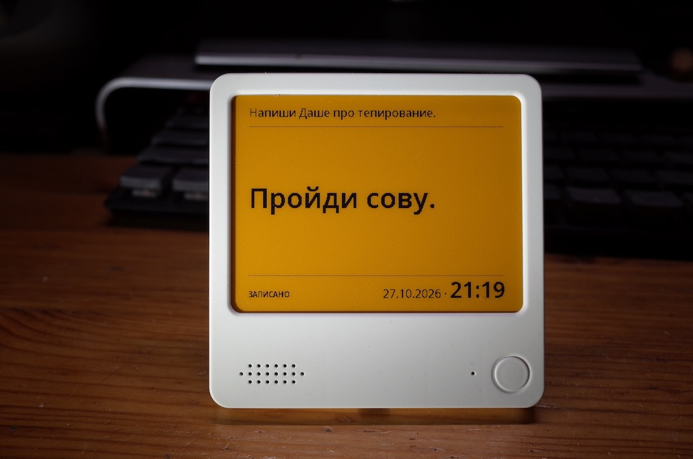

# Note4C Voice

**English** · [Русский](README-ru.md)

Voice-note firmware for the Zectrix Note4C: ESP32-S3, 16 MB flash,
8 MB PSRAM, HE042A268 / SSD2683 400 × 300 color e-paper and ES8311 codec.

Press the round button, speak, and the device sends the recording to a
speech-to-text server on your network and shows the recognized text on the
e-ink screen. It keeps the last 7 notes, which you can browse and delete.

The on-device interface and the setup page are in Russian, and recognition
requests Russian (`language=ru`).

**Version of 9 November 2026:** the transcription server address and the
time zone are set on the setup page. Tested on the device on
9 November 2026.

**Version of 1 November 2026:** 7-note ring buffer, browsing and deletion.
Flashed with NVS preserved; the USB log confirmed boot and a full screen
refresh in 24.042 seconds. On-device testing of the buffer and button
scenarios is still pending.
Details (in Russian): [docs/VALIDATION.md](docs/VALIDATION.md).



▶ [Demo video (YouTube)](https://www.youtube.com/shorts/uhrAeJdXi-o)

## Controls

- **Short round press:** record a new note from any browsing position.
  After releasing, wait for the beep, then speak. The new note becomes
  current; the others are kept in chronological order. Up to 7 notes,
  including the one shown. The eighth one evicts the oldest, regardless
  of the browsing position.
- **Down + short round press:** delete the displayed note. The next older
  note appears; after deleting the oldest one, the newest is shown.
- **Up + short round press:** go to the next newer note. After the newest,
  the oldest remaining note is shown.
- **Hold round button for 3 seconds:** settings; holding takes priority
  over the side buttons.

Hold the side button while pressing the round one: the round button wakes
the device from deep sleep. Both side buttons together with a short round
press are ignored. With a single note, Up changes nothing and does not
refresh the screen. With an empty buffer, both commands do nothing.

Recording stops after 2 seconds of silence following speech, on a second
press, or after 30 seconds. If no speech starts within 5 seconds, a
"no speech" message appears. Two short beeps mark the end of recording.
After the upload and screen refresh, the device goes to sleep. Presses
during upload and refresh are ignored; a held button must be released and
pressed again.

## Screen and history

Black text on a yellow background. The top line is **the text that was on
the main screen right before the last change**. It is a separate screen
history, not the neighbouring note in the buffer.

Example: record A, then B — A on top, B large. Delete B — B on top, A large,
even though B is already gone from the buffer. Wrapping from the newest
note to the oldest also moves the previous main text to the top line.
A service message can end up in the top line but is never stored as a note
in the ring buffer.

After deleting the last note **the whole screen is plain yellow**, with no
top line, date or separators. After a new recording from an empty screen
the top line is empty too. RESET and leaving settings restore the selected
note and its top line without shifting the history.

The top line uses a 16 px font and is truncated with `...`. The date and
time at the bottom are when the displayed note was recorded, in the time
zone from the settings. Date 16 px, time 30 px, shared baseline. Dotted
separators: Y=43 (when there is a top line) and Y=248 (when there is a
date). The main font shrinks until the text fits. The limit is 160 Unicode
characters after whitespace normalization; longer text is cut to 159
characters plus `…`. Cyrillic, ASCII and common punctuation are supported;
other characters are replaced with `?`.

Examples rendered from the real firmware framebuffer:
[two notes](docs/screen-history.png),
[after deletion](docs/screen-after-delete.png),
[empty screen](docs/screen-empty.png),
[wide glyphs](docs/screen-history-wide.png).

A new recording, navigation and deletion each do a **full e-ink refresh**
(24.042 seconds measured on the 1 November build). Intermediate recording
and upload states do not touch the screen. Browsing and deletion do not
turn on Wi-Fi or audio. A partial-refresh experiment lives separately in
[experiments/partial-lines](experiments/partial-lines/README.md) (in Russian).

## Persistence and updates

The buffer, selected position, dates, top-line text and the last service
message are stored in NVS separately from the Wi-Fi settings. After deep
sleep the screen is not redrawn; after RESET and leaving settings the
selected note (or the empty screen) is fully restored.

Settings from the 1 November version and earlier are migrated: Wi-Fi, NTP
and volume are kept, the time zone becomes `MSK-3`, but they contain no
server address, so the setup portal opens on first boot with the other
fields prefilled.

When updating by segments with NVS preserved, the current and previous
notes of the 11 October version are migrated. The "done" strike-through is
reset. The old previous note had no stored date, so it is migrated without
one. The NVS formats changed: firmware older than 9 November reads neither
the new buffer nor the new settings.

Before changing the screen, an "update in progress" flag is saved; the new
state is committed after a successful refresh. If the screen or the NVS
write fails, the last committed state is kept. Three LED flashes signal an
error; RESET restores the saved state.

## First-time setup

After flashing, the screen shows connection instructions:

1. Connect a phone or computer to the Wi-Fi network `NOTE4C-VOICE-XXXX`.
   Access point password: **`NOTE4CVOICE`**.
2. Open **http://192.168.4.1/** if the page does not open by itself.
3. Enter your **2.4 GHz** network and password, the transcription server
   URL (for example `http://192.168.1.10:8000/v1/audio/transcriptions`)
   and the time zone as a POSIX TZ string (default `MSK-3`). Optionally
   change the NTP server and beep volume (40–100, default 85). Save.
4. Wait for the instructions on the e-ink screen. The next round-button
   press starts recording.

Settings are stored in NVS. For the same SSID, an empty password field
keeps the saved password; open networks have a separate checkbox. To open
the settings again, hold the round button for 3 seconds.

The time zone is a POSIX TZ string, not a name such as `Europe/Moscow`:

| Zone | String |
|---|---|
| Moscow | `MSK-3` |
| UTC | `UTC0` |
| Berlin | `CET-1CEST,M3.5.0,M10.5.0/3` |
| New York | `EST5EDT,M3.2.0,M11.1.0` |
| India | `<+0530>-5:30` |

The portal closes after saving, cancelling or 10 minutes of inactivity.

The clock is taken from the phone/computer when settings are saved. The
ESP32 keeps time in deep sleep. When Wi-Fi is up, NTP sync runs
periodically during server requests. After a full power loss the time is
restored via NTP; if that fails, the portal opens to take the time from the
phone. The board's separate hardware RTC is not used in this version.

## Server and errors

Any OpenAI-compatible transcription service reachable over **HTTP** works
(HTTPS is not supported), for example a local
[speaches (faster-whisper-server)](https://github.com/speaches-ai/speaches).
The URL is set in the settings as `http://host[:port]/path`:

```text
POST <URL from settings>
Content-Type: multipart/form-data
file: speech.wav — PCM signed 16-bit little endian, mono, 16000 Hz
model: whisper-1
language: ru
response_format: json
```

Expected response: `{"text":"recognized phrase"}`. No Authorization header
is sent. Audio is streamed over HTTP on the local network straight from
PSRAM, without base64. It is never written to flash and is freed after the
request. Flash holds up to 7 text notes, their dates and the screen
history; there is no audio archive.

On missing Wi-Fi, connection error, timeout, HTTP 408 or 5xx the firmware
shows (in Russian) "Transcription service on `<host>` is unavailable".

This message temporarily replaces the note on screen; the buffer is not
changed. Down on that screen restores the selected note without deleting
it; Up moves to the next one. Other HTTP errors, malformed JSON, empty
text, no speech and audio errors have their own messages. The response
limit is 16 KiB. One request per recording: up to 15 seconds waiting for
Wi-Fi after recording, 5 seconds HTTP connect, 60 seconds waiting for
network data (a read timeout, not a hard limit on the whole operation).
There is no retry.

## Audio

Uses Espressif's ES8311 driver over I2C `0x18`, I2S duplex 16 kHz, 16 bit,
two slots. The active mono channel is picked from the input slots. 0.5
seconds of calibration run before the ready beep; don't speak yet.

Ready: 1200 Hz, 120 ms. Done: two 800 Hz beeps of 80 ms with an 80 ms gap.
The beeps are separate WAV files:

- [`assets/sounds/record-start.wav`](assets/sounds/record-start.wav) — before recording;
- [`assets/sounds/record-stop.wav`](assets/sounds/record-stop.wav) — after recording stops,
  whether by a second press, silence or the length limit.

The files are embedded in flash at build time. You can replace them with
your own: **uncompressed PCM WAV, mono, 16 bit, 16000 Hz, up to 5 seconds**
each, then rebuild. Unsupported formats are rejected at build time.
`python3 tools/generate_sounds.py` restores the default sounds; a normal
build does not run it and does not overwrite custom WAVs.

Before each beep, zero samples prime I2S, then the amplifier is enabled
and given time to start. After the WAV, silence longer than the whole DMA
buffer is sent before the amplifier is turned off. Voice capture starts
only after the first beep finishes. Default tones have soft edges. Input
buffers are flushed of the beep before recording; the end beeps play after
the buffer end is fixed. The amplifier is off while recording.

The round and side button states at early init are kept until the action
is chosen. A short press is detected after a stable release; a 3-second
hold opens settings. A USB boot without a press and leaving settings
restore the saved note; with no notes the screen stays empty. The USB log
contains the boot reason and start/end lines for playback and recording.

The pause detector is level-based, with background-noise calibration, a DC
filter and at least 60 ms of activity. It is not a speech model: a TV or
constant loud noise can extend recording to the limit. Microphone gain and
threshold may need tuning per device; the parameters are in
`src/audio.cpp` and `include/voice_logic.h`.

| Function | GPIO |
|---|---|
| Round button / side Up, Down / LED | 0 / 39, 18 / 3 |
| Battery power latch | 17 |
| Audio power / amplifier | 42 / 46 |
| I2S MCLK / BCLK / WS | 14 / 15 / 38 |
| ESP32 TX → codec / codec → ESP32 RX | 45 / 16 |
| I2C SDA / SCL | 47 / 48 |
| EPD power / busy / reset / dc / cs / sck / mosi | 6 / 8 / 9 / 10 / 11 / 12 / 13 |

## Build and flash

From the project root:

```bash
python3 -m venv .venv
.venv/bin/pip install -r requirements.txt
.venv/bin/pio run
```

Pinned: PlatformIO 6.1.19, espressif32 6.12.0 / Arduino-ESP32 2.0.17.
After a build, `dist/` holds the merged image, the individual segments and
`SHA256SUMS`; it is not tracked in git. Fonts and the codec driver are
included in the sources; no generation step is needed for a normal build.

First install (port is `/dev/cu.usbmodem…` on macOS, `/dev/ttyACM0` on
Linux, `COMx` on Windows):

```bash
.venv/bin/python -m esptool --chip esp32s3 --port PORT --baud 460800 \
  write_flash 0x0 dist/note4c-voice-merged.bin
```

The device must be connected over USB and reachable by the bootloader; in
deep sleep the USB port disappears — press the round button. The merged
image rewrites the NVS area, so Wi-Fi must be configured afterwards.
Consider backing up the stock firmware first:
`.venv/bin/python -m esptool --chip esp32s3 --port PORT read_flash 0 0x1000000 backup.bin`.

Update keeping settings and notes (same partition table):

```bash
.venv/bin/python -m esptool --chip esp32s3 --port PORT --baud 460800 \
  write_flash 0xe000 dist/boot_app0.bin 0x10000 dist/firmware.bin
```

`boot_app0.bin` selects the first app partition; NVS is untouched. Older
versions cannot read the new buffer and settings formats.

Host-side tests (Python 3 and a C++ compiler with ASan/UBSan):

```bash
python3 tools/check.py
python3 tools/check.py --wav /path/to/mono-16k-pcm16.wav
```

The second form also builds `test-output/request.multipart` with the
firmware code and checks it independently with Python's MIME/WAV parsers.
Neither command makes network requests. PNG previews are generated from
the real 400 × 300 framebuffer, not from an HTML mockup.

To change fonts, install Pillow 11.3.0 and run
`python3 tools/generate_fonts.py`. Sources and licenses are listed in
[THIRD_PARTY.md](THIRD_PARTY.md).

## License

GPL-3.0-only, see [LICENSE](LICENSE). Third-party components are listed in
[THIRD_PARTY.md](THIRD_PARTY.md).
